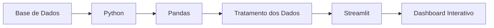

# 📊 Painel de Análise de BI

## 📋 Sobre o Projeto

Dashboard de Business Intelligence desenvolvido para análise de indicadores estratégicos e apoio à tomada de decisão orientada por dados.

Utiliza Python, Pandas e Streamlit para coleta, tratamento e visualização de dados, permitindo monitorar indicadores de desempenho por meio de dashboards, gráficos e análises interativas.

---

## 🎯 Objetivos

- Transformar dados em informações estratégicas.
- Facilitar a tomada de decisão baseada em dados.
- Monitorar indicadores de desempenho (KPIs).
- Identificar tendências e oportunidades de melhoria.
- Disponibilizar informações de forma visual e acessível.

---

## ✅ Funcionalidades

- Dashboard interativo.
- Visualização gráfica de indicadores.
- Análise de tendências.
- KPIs em tempo real.
- Relatórios gerenciais.
- Filtros dinâmicos para exploração dos dados.
- Acompanhamento de desempenho.

---

## 🏛️ Arquitetura da Solução

---

## 📈 Indicadores Monitorados

- Total de vendas
- Receita acumulada
- Ticket médio
- Crescimento mensal
- Desempenho por categoria
- Evolução temporal
- Indicadores de performance

---

## 🛠️ Tecnologias Utilizadas

- Python
- Pandas
- Streamlit
- SQL
- Plotly
- Git
- GitHub

---

## 💼 Valor de Negócio

Este projeto demonstra a aplicação de conceitos de Business Intelligence e Análise de Dados para transformar informações em conhecimento útil para a tomada de decisões.

Por meio de dashboards interativos, gestores podem acompanhar indicadores estratégicos, identificar tendências e monitorar resultados de forma eficiente.

---

## 📊 Benefícios

- Apoio à tomada de decisão baseada em dados.
- Visualização rápida dos resultados.
- Centralização das informações estratégicas.
- Monitoramento contínuo de indicadores.
- Identificação de tendências e oportunidades de melhoria.
- Redução do tempo gasto em análises operacionais.

---

## 🚀 Demonstração

A aplicação está disponível online para visualização dos dashboards, indicadores e análises interativas.

🔗 Acesse a versão publicada pelo link disponível neste repositório.

---

## 📚 Conceitos Aplicados

- Business Intelligence (BI)
- Data Analytics
- Visualização de Dados
- Indicadores de Desempenho (KPIs)
- Tomada de Decisão Baseada em Dados
- Storytelling com Dados
- Tratamento e Limpeza de Dados
- Dashboards Interativos

---

## 🏆 Competências Demonstradas

- Business Intelligence
- Análise de Dados
- Visualização de Dados
- Python para Análise de Dados
- KPIs e Métricas de Negócio
- Storytelling com Dados
- Dashboards Interativos
- Tomada de Decisão Baseada em Dados

---

## 🛣️ Roadmap

### Fase 1 - Estruturação

- [x] Levantamento dos indicadores
- [x] Estruturação dos dados
- [x] Desenvolvimento inicial do dashboard

### Fase 2 - Análise

- [x] Visualização de KPIs
- [x] Gráficos interativos
- [x] Filtros analíticos

### Fase 3 - Evolução

- [ ] Dashboard executivo
- [ ] Exportação de relatórios
- [ ] Integração com APIs
- [ ] Atualização automática dos dados

---

## 👩‍💻 Desenvolvido por

**Maristela Costa**

🎓 Bacharel em Sistemas de Informação

🔐 MBA em Cibersegurança e Proteção de Dados (em andamento)

📊 MBA em Business Intelligence, Big Data e Analytics (em andamento)

💻 Desenvolvedora e Analista de Sistemas em formação

🌐 GitHub: github.com/Maristelacosta
